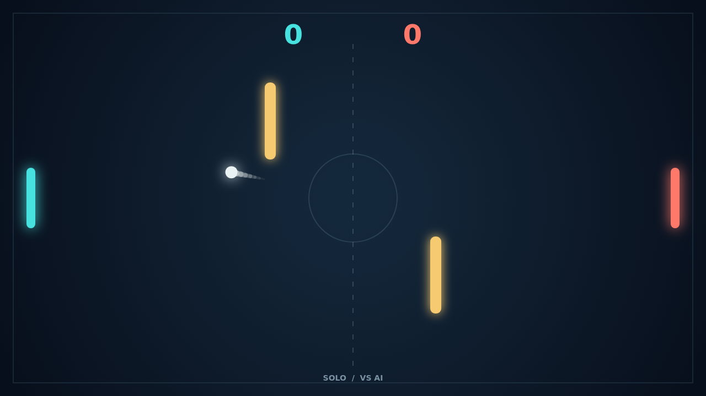

# Carom

The ball leaves center court and the chase begins. Slide your paddle into the shot, catch an edge, and send the rally back across the dark field. Two gold barriers turn every exchange into a choice of lanes and bank shots.

Move while you strike and the ball bends after contact. A quick upward sweep can pull a shot around a blocker; a downward cut can make an ordinary return dip late. The trail shows the curve you created, so every clever hit has a visible signature.

In Solo, challenge the right-side AI. In Versus, share a keyboard and trade shots with a friend. Each point sends the next serve toward the player who conceded it, and the match stays alive at deuce until someone leads by two.

